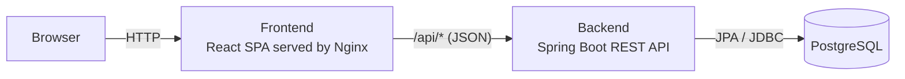

# 💰 Finance Tracker

> A personal finance web app for tracking income, expenses, categories and monthly budgets, built with **Java 25 / Spring Boot**, **PostgreSQL** and **React + TypeScript**.


---

## Overview

**Finance Tracker** helps you see where your money goes. You record income and expenses, organise them into categories, set a monthly spending budget, and get a dashboard and statistics computed from your real transaction data.

It is also a learning project. The goal is a small, well-built application that follows good engineering practice: a clean layered architecture, database migrations, validation, consistent error handling, automated tests, API documentation and a fully containerised setup.

> **Status:** early development. See the [Roadmap](ROADMAP.md) for progress.

---

## Features (MVP)

| Area | What you can do |
|---|---|
| **Dashboard** | Current balance, monthly income and expenses, remaining budget, recent transactions, expenses by category and an income-vs-expenses chart. Browse previous months. |
| **Transactions** | Create, edit and delete transactions. Filter by date range, category and type, search by description, sort by date or amount, paginate. |
| **Categories** | Default income and expense categories, plus custom categories with a colour and description. Categories still in use can't be deleted. |
| **Budgets** | Set a monthly spending budget and see the amount spent, the amount remaining and the percentage used. Browse budget history. |
| **Statistics** | Monthly income, expenses and savings, a category breakdown and income-vs-expense comparisons for any period. |

**Not in the MVP:** bank integrations, CSV import, multi-currency, forecasting, AI insights and mobile apps. The architecture is designed so these can be added later.

---

## Tech Stack

### Backend
| Technology | Purpose |
|---|---|
| **Java 25 (LTS)** | Language |
| **Spring Boot 4** | Application framework |
| **Spring Web MVC** | REST API |
| **Spring Data JPA / Hibernate** | Persistence and ORM |
| **Bean Validation** | Request validation |
| **Spring Security** | Security configuration (CORS), ready for future authentication |
| **Flyway** | Versioned database migrations |
| **springdoc-openapi** | OpenAPI spec and Swagger UI |
| **Maven** | Build and dependency management |

### Database
| Technology | Purpose |
|---|---|
| **PostgreSQL 18** | Relational database. Money is stored as `NUMERIC` and mapped to `BigDecimal`. |

### Frontend
| Technology | Purpose |
|---|---|
| **React 19 + TypeScript** | UI |
| **Vite** | Dev server and build |
| **Tailwind CSS** | Styling |
| **React Router** | Routing |
| **TanStack Query** | Server-state fetching and caching |
| **React Hook Form + Zod** | Forms and validation |
| **Recharts** | Charts |

### Testing and tooling
| Technology | Purpose |
|---|---|
| **JUnit 5, Mockito, AssertJ** | Unit tests |
| **Spring Boot Test + Testcontainers** | Integration tests against a real PostgreSQL |
| **Vitest, React Testing Library, MSW** | Frontend tests |
| **Docker + Docker Compose** | Containerised local environment |
| **GitHub Actions** | Continuous integration |
| **Bruno** | API collection (versioned in this repo) |

---

## Architecture

The app is a **modular monolith**: one Spring Boot backend, one PostgreSQL database and one React single-page app. The frontend talks to the backend only through the REST API.



**Backend layers** (organised by feature: `category`, `transaction`, `budget`, `statistics`, `dashboard`):

```
Controller  →  Service  →  Repository  →  PostgreSQL
 (HTTP, DTOs)   (business rules,   (Spring Data JPA)
                 transactions)
```

- JPA entities are never exposed. The API uses request and response DTOs.
- Errors follow [RFC 9457 Problem Details](https://www.rfc-editor.org/rfc/rfc9457), so every error response has the same shape.
- The schema is owned by Flyway migrations. Hibernate only validates it.
- The data model is **multi-user ready** (every record has an owner), even though the MVP runs in single-user mode.

---

## Project Structure

```
finance-tracker/
├── backend/              # Spring Boot application (Maven)
├── frontend/             # React + TypeScript + Vite application
├── bruno/                # Bruno API collection
├── docs/                 # Architecture notes and decision records (ADRs)
├── docker-compose.yml    # db + backend + frontend
├── .env.example          # Environment variable template
├── ROADMAP.md
└── README.md
```

> Folders are added as each phase of the [roadmap](ROADMAP.md) is completed.

---

## Getting Started

> ⚠️ These instructions describe the target setup. They will work once the matching roadmap phases are complete.

### Prerequisites
- [Docker](https://docs.docker.com/get-docker/) and Docker Compose
- *For local development only:* JDK 25 and Node.js 24 LTS

### Run the full application with Docker

```bash
git clone https://github.com/<your-username>/finance-tracker.git
cd finance-tracker
cp .env.example .env          # then edit the passwords
docker compose up -d --build
```

| Service | URL |
|---|---|
| Web app | http://localhost:3000 |
| REST API | http://localhost:8080/api |
| Swagger UI | http://localhost:8080/swagger-ui.html |
| Health check | http://localhost:8080/actuator/health |

### Local development

```bash
# 1. Start only the database
docker compose up -d db

# 2. Backend (http://localhost:8080)
cd backend
./mvnw spring-boot:run

# 3. Frontend (http://localhost:5173, proxies /api to the backend)
cd frontend
npm install
npm run dev
```

---

## ⚙️ Configuration

All configuration comes from environment variables (see [`.env.example`](.env.example)). No credentials are stored in the source code.

| Variable | Description | Example |
|---|---|---|
| `POSTGRES_DB` | Database name | `finance_tracker` |
| `POSTGRES_USER` | Database user | `finance` |
| `POSTGRES_PASSWORD` | Database password | *(set your own)* |
| `DB_URL` | JDBC URL used by the backend | `jdbc:postgresql://localhost:5432/finance_tracker` |
| `DB_USERNAME` / `DB_PASSWORD` | Backend database credentials | — |
| `APP_CORS_ALLOWED_ORIGINS` | Allowed frontend origins | `http://localhost:5173` |

---

## API Documentation

- **Swagger UI:** `http://localhost:8080/swagger-ui.html` (interactive documentation, generated from the code)
- **OpenAPI spec:** `http://localhost:8080/v3/api-docs`
- **Bruno collection:** open the [`bruno/`](bruno/) folder in [Bruno](https://www.usebruno.com/)

Main resources (✅ available; the rest are planned in the [roadmap](ROADMAP.md)):

| Resource | Endpoints |
|---|---|
| Categories ✅ | `GET/POST /api/categories`, `GET/PUT/DELETE /api/categories/{id}` |
| Transactions | `GET/POST /api/transactions`, `GET/PUT/DELETE /api/transactions/{id}` |
| Budgets | `GET/POST /api/budgets`, `GET/PUT/DELETE /api/budgets/{year}/{month}` |
| Dashboard | `GET /api/dashboard?year=&month=` |
| Statistics | `GET /api/statistics/monthly`, `/categories`, `/summary` |

### Categories

| Method | Path | Success | Errors |
|---|---|---|---|
| `GET` | `/api/categories?type=EXPENSE` (`type` optional) | 200, sorted by type then name | 400 |
| `GET` | `/api/categories/{id}` | 200 | 404 |
| `POST` | `/api/categories` | 201 + `Location` | 400, 409 |
| `PUT` | `/api/categories/{id}` | 200 | 400, 404, 409 |
| `DELETE` | `/api/categories/{id}` | 204 | 404, 409 |

- Not paginated: a user has a small, bounded list of categories.
- Names are unique per type, ignoring case: `Coffee` and `coffee` can't both be expense categories (409).
- A category used by transactions can't change its type or be deleted (409, with the number of transactions).
- Another user's category behaves as if it didn't exist (404).

---

## Testing

```bash
# Backend: unit tests
cd backend && ./mvnw test

# Backend: unit + integration tests (Testcontainers, requires Docker)
cd backend && ./mvnw verify

# Frontend
cd frontend && npm test
```

The backend tests cover four levels: service unit tests with Mockito, controller slice tests, repository tests, and full API integration tests against a real PostgreSQL database run with Testcontainers.

---

## Future Ideas

- User accounts and authentication
- Per-category budgets
- CSV import of bank statements
- Recurring transactions and subscription tracking
- Multi-currency support

---

## 📄 License

To be decided. A license will be added before the first release.
